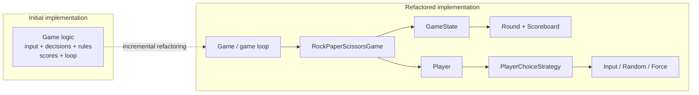

# Rock–Paper–Scissors: A Java Refactoring Case Study

A small console game used to explore **incremental refactoring, object-oriented design, and testability**. The interesting part isn't the game itself:it's how the implementation evolves from tightly coupled logic to clearly separated responsibilities.

**Java 23 · Maven · JUnit 5 · Strategy pattern · Template Method-style game loop**

## The evolution

| Version | Approach | What changed |
| --- | --- | --- |
| [Initial : `refactor/000`](https://github.com/lefpap/rock-paper-scissors/tree/refactor/000) | A straightforward game | Input, rules, scoring and control flow live close together |
| [First refactor : `refactor/001`](https://github.com/lefpap/rock-paper-scissors/tree/refactor/001) | Extract responsibilities | Configuration, smaller methods and error handling |
| [Final design : `refactor/002`](https://github.com/lefpap/rock-paper-scissors/tree/refactor/002) | Separate behavior from state | Game loop, round/score management and choice strategies |

The branches are snapshots for comparing approaches; `master` contains the current implementation.

### Before → after



## Design decisions

**A reusable game loop.** `Game.run()` owns the lifecycle: initialize, run rounds until the game is over, and invoke optional hooks. `RockPaperScissorsGame` supplies the game-specific behavior. This resembles the *Template Method* pattern.

**Strategies for making choices.** A `Player` delegates to `PlayerChoiceStrategy`. Console input, random decisions and deterministic choices are interchangeable, so rule tests don't depend on interactive input or randomness.

**State kept separate.** `GameState`, `Round`, and `Scoreboard` track outcomes and scores separately from console presentation and player input.

**A deliberate trade-off.** This is more abstraction than a tiny console game needs. The point is to compare design approaches and practice introducing seams for testing:not to claim that every small game requires a framework.

## Run locally

**Prerequisite:** JDK 23 or newer.

```bash
git clone https://github.com/lefpap/rock-paper-scissors.git
cd rock-paper-scissors
./mvnw clean verify
java -jar target/rock-paper-scissors-1.0-SNAPSHOT.jar
```

On Windows, use `mvnw.cmd` instead of `./mvnw`. The console game pits a human player against a computer; the first to three points wins.

## Tests

JUnit 5 tests cover game state, rounds, scoring and player choices. Run them with:

```bash
./mvnw test
```

The [GitHub Actions workflow](.github/workflows/ci.yml) runs the Maven verification build on pushes and pull requests.

## Explore the code

- [Game loop](src/main/java/com/lefpap/game/Game.java)
- [Rock–Paper–Scissors implementation](src/main/java/com/lefpap/game/RockPaperScissorsGame.java)
- [Game state](src/main/java/com/lefpap/gamestate/GameState.java)
- [Choice strategies](src/main/java/com/lefpap/player/strategy)
- [Unit tests](src/test/java/com/lefpap)

This repository is intentionally a **refactoring exercise**, not a production game or a feature roadmap.
